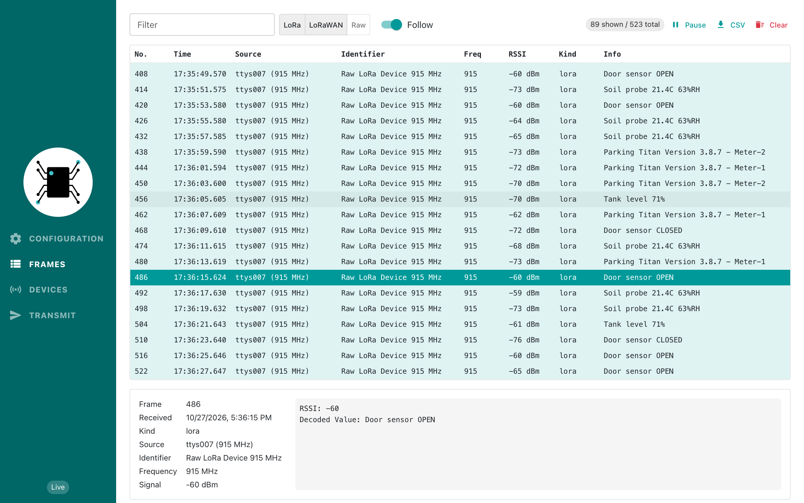
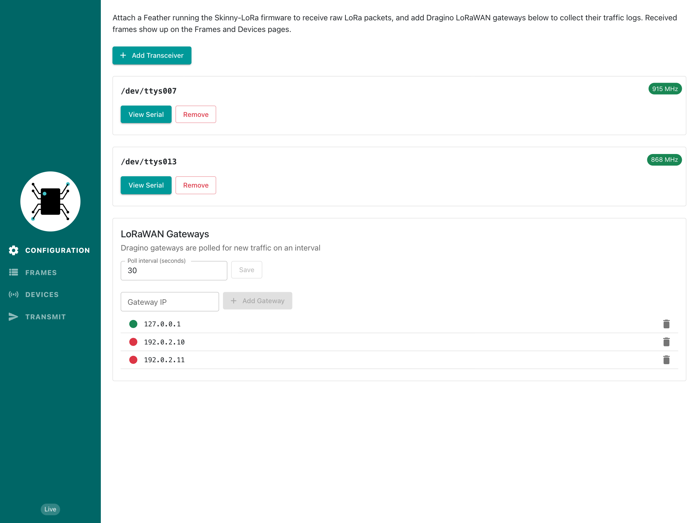
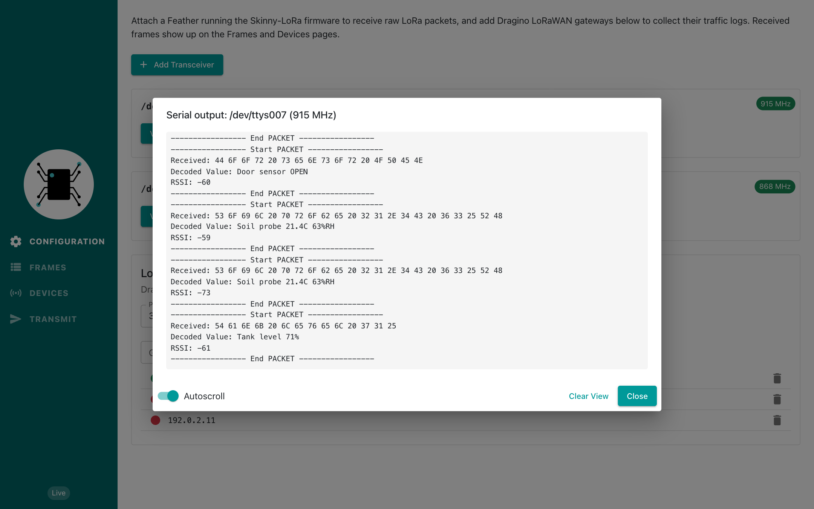
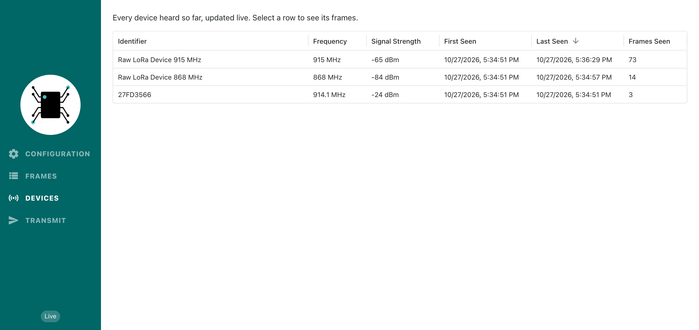
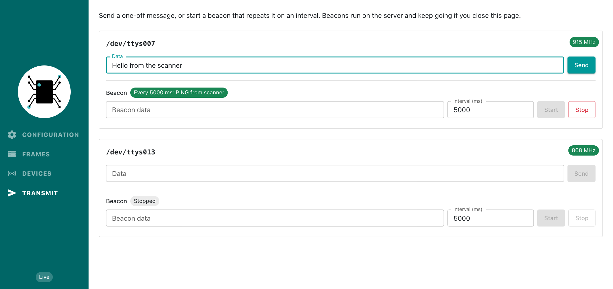

# Skinny R&D Lora Scanner

A single-binary web application for monitoring and analyzing LoRa (Long Range) wireless traffic. The backend is Go ([gin](https://github.com/gin-gonic/gin)); the frontend is React with [MUI](https://mui.com), built with [bun](https://bun.sh) and embedded in the binary. It needs no internet access to run.



## Features

* **Live frames**: a Wireshark-style list of everything received (raw serial lines, decoded LoRa packets, LoRaWAN gateway traffic) with filtering, pause/follow and CSV export.
* **Devices**: a live table of every device heard, with frequency, signal strength, first/last seen and frame count.
* **Any number of transceivers**: add as many Feathers as you like; each one's frequency (433, 868, 915 MHz, ...) is detected automatically from the firmware's boot banner. View any device's raw serial output.
* **Transmit**: one-off messages and server-side beacons that keep running when the page is closed.
* **LoRaWAN gateways**: add any number of Dragino LPS8N gateways; their traffic logs are polled on a configurable interval.
* **Hardware**: an `Adafruit Feather M0` or `32u4` running the [Skinny LoRa](https://github.com/skinnyrad/Skinny-LoRa) firmware (steps 1-2 in its README). *For 433 MHz you need the `Adafruit Feather M0 LoRa 433 MHz`.*

## Build and run

Requires Go 1.24+ and [bun](https://bun.sh).

```
make build          # bun builds web/dist, then go build -> ./lora-scanner
./lora-scanner      # http://localhost:5000
```

The result is one self-contained binary. The frontend uses no CDNs or web fonts, and `make build` fails if it ever references anything that isn't embedded. Every route under `/api` is the JSON/WebSocket API; any other URL serves the web interface.

Options:

| Option | Default | Purpose |
|---|---|---|
| `--addr` / `LORA_ADDR` | `:5000` | listen address |
| `--config` / `LORA_CONFIG` | `gateways.json` in the per-user config directory | gateway list and poll interval |
| `LORA_GATEWAY_USER` / `LORA_GATEWAY_PASS` | `root` / `dragino` | gateway web login |

The config directory is `~/.config/lora-scanner/` on Linux, `~/Library/Application Support/lora-scanner/` on macOS and `%AppData%\lora-scanner\` on Windows, so the binary can live anywhere, including a read-only `bin`. On first run, an old `gateway_config.json` in the working directory is imported if present (and never modified).

Development: `make dev` runs the API; in another shell `cd web && bun run dev` (the Bun dev server on :5173 proxies `/api` to port 5000). Tests: `make test`.

## Usage

*The screenshots below were taken against simulated Feathers and a stand-in gateway.*

### Configuration



Click *Add Transceiver* and pick the serial port of a Feather. Its frequency shows up once the firmware reports it (the Feather prints it once at boot, so replug a board that shows "Detecting…"). Add as many as you like, including several on the same band.

*View Serial* shows everything a device prints, read-only:



Add Dragino gateways by IP, with no limit. A gateway turns red after two failed polls in a row and is retried every 5 seconds until it answers; green means its last poll worked, and grey means it hasn't been polled yet. The poll interval (5-3600 seconds, default 30) is set here too.

### Frames


Every frame as it arrives: raw serial lines, decoded LoRa packets and LoRaWAN gateway rows (the last 10,000 are kept). Filter by text or kind (LoRa, LoRaWAN, Raw), select a row for its details, pause the view, or download everything as CSV. *Follow* keeps the newest frame in view and switches itself off when you scroll up.

### Devices



A live table of every device heard: identifier, frequency, signal strength, first and last seen, and how many frames it has sent. Select a device to jump to its frames.

### Transmit



The only place anything is transmitted. Send a message from a chosen transceiver, or start a beacon that repeats it every N milliseconds (minimum 1000) to probe nearby devices. Beacons run on the server and keep going if you close the page.

## API

| Endpoint | Purpose |
|---|---|
| `GET /api/ports` | serial ports on this machine |
| `GET/POST /api/transceivers` `{port}` | list / add a Feather; its frequency is detected from the firmware's `Freq set to:` boot line |
| `DELETE /api/transceivers/{id}` | remove |
| `POST /api/transceivers/{id}/transmit` `{text}` | send `TX:<text> ` |
| `GET/POST/DELETE /api/transceivers/{id}/beacon` | server-side periodic transmit (`{text, intervalMs>=1000}`) |
| `GET/PUT /api/gateways/poll` `{seconds}` | how often gateways are polled |
| `GET/POST /api/gateways` `{ip}`, `DELETE /api/gateways/{ip}`, `GET /api/gateways/status` | gateway list and each gateway's state from its last poll (`online`/`offline`/`unknown`, with the error) |
| `GET /api/frames?after=<id>`, `DELETE /api/frames`, `GET /api/frames.csv` | received frames (last 10,000 kept) |
| `GET /api/devices` | devices aggregated from frames |
| `GET /api/ws` | WebSocket: live `transceivers`, `gateways` (state changes), `frame` and `device` messages |

## SDR companion

`sdr-companion/` has GNU Radio tooling for capturing LoRa with an SDR; see [`sdr-companion/sdr-companion.md`](./sdr-companion/sdr-companion.md).

## License

MIT, see [LICENSE](./LICENSE).
